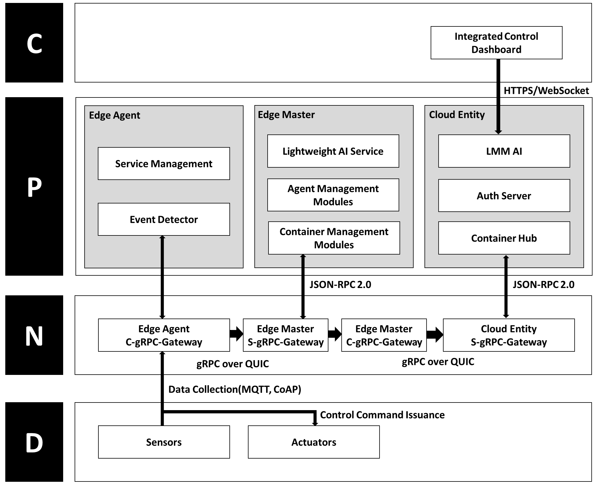
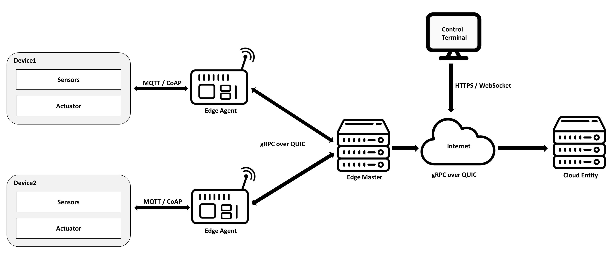
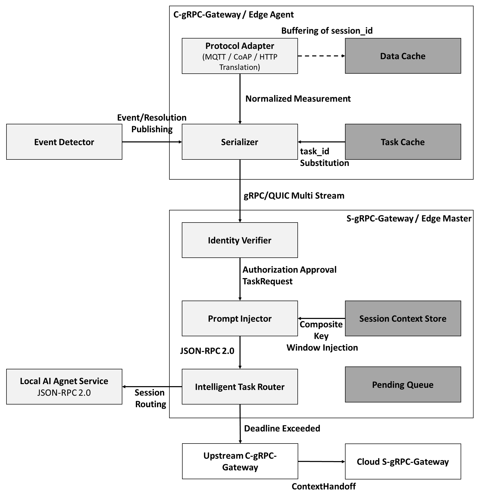
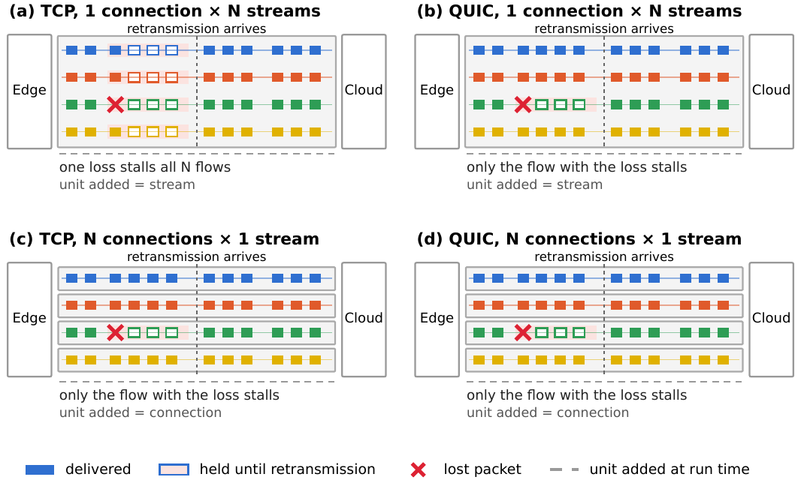
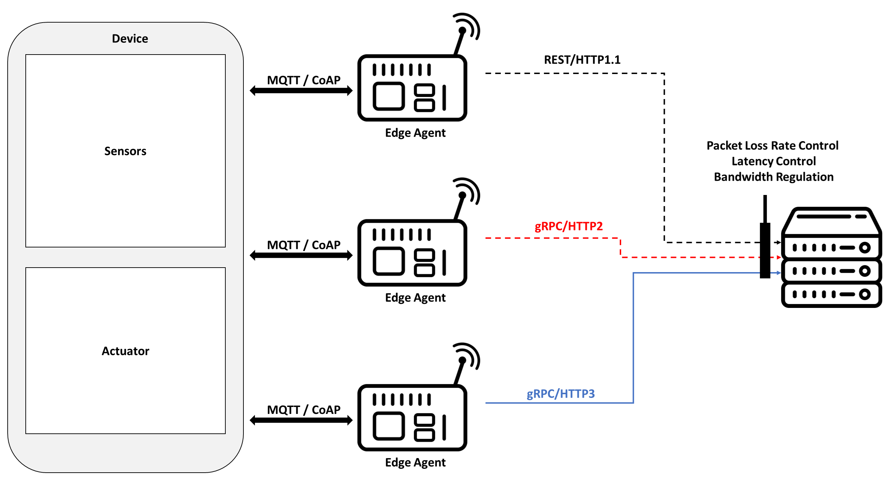
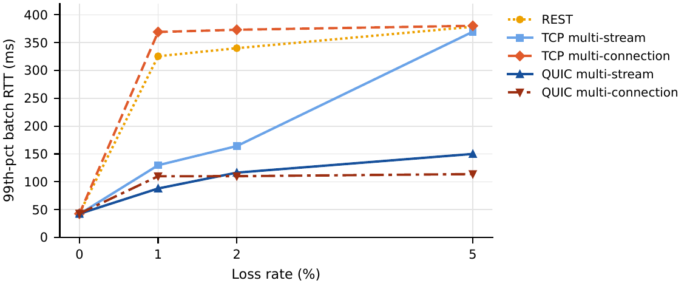
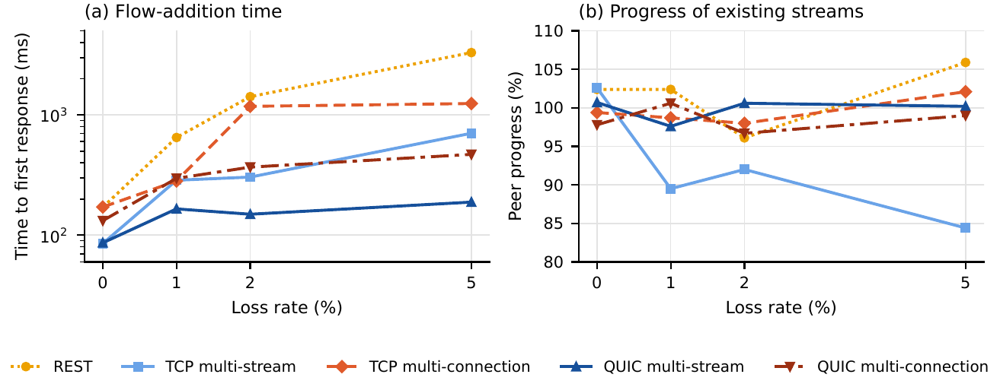
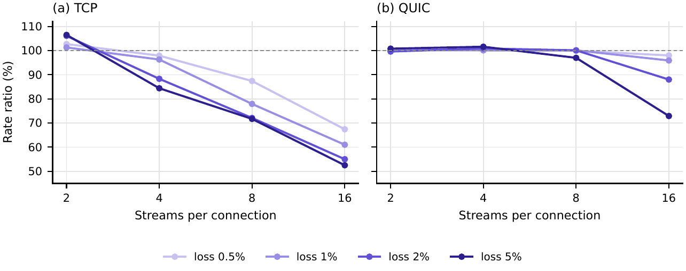

# A gRPC-over-QUIC Multi-Stream Gateway for Multi-Agent AIoT Services

Testbed, experiment scripts and measured data for the paper

> G.-S. Shin and S.-J. Koh, "A gRPC-over-QUIC Multi-Stream Gateway Architecture for
> Multi-Agent AIoT Services and Its Evaluation over Lossy Edge Links,"
> submitted to *Computers and Electrical Engineering*, 2026.

Agents that drive IoT devices exchange several kinds of data with them — sensor time
series, task requests, control commands and occasional bulk data such as camera frames —
over lossy wireless edge links. This repository implements the transport part of the
proposed architecture, a pair of gRPC gateways that carry each data type on its own
QUIC stream of one connection, and the benchmark used to compare it with REST and with
gRPC over TCP under controlled loss.

## Design



The system is placed on a four-layer client–platform–network–device model. A sending
gateway (C-gRPC-Gateway) and a receiving gateway (S-gRPC-Gateway) sit at the two ends of
each link, so that only gRPC over QUIC crosses the link while MQTT/CoAP toward devices
and JSON-RPC 2.0 toward AI services are kept as they are. The same gateway pair is
applied between the Edge Agent and the Edge Master and between the Edge Master and the
Cloud Entity.





## Stream mapping

Each data type is one gRPC streaming call carried on one QUIC stream of a single
connection. Telemetry streams, a task stream and a downward control stream stay open;
a bulk stream is opened on demand. A new data type adds a stream without a handshake.



The experiments separate the effect of the transport protocol from that of the number
of connections with five configurations that share the same application code:

| Configuration | Code name | Connections × streams | Transport / application |
|---|---|---|---|
| REST | `rest` | N × 1 | TCP / HTTP/1.1, JSON |
| TCP multi-stream | `grpc` | 1 × N | TCP / gRPC over HTTP/2 |
| TCP multi-connection | `grpcm` | N × 1 | TCP / gRPC over HTTP/2 |
| **QUIC multi-stream (proposed)** | `h3` | 1 × N | QUIC / gRPC over HTTP/3 |
| QUIC multi-connection | `h3m` | N × 1 | QUIC / gRPC over HTTP/3 |
| control arm (not in the paper's tables) | `qtun` | 1 × N | QUIC / gRPC framing without HTTP/3 |

## Testbed



| Item | Value |
|---|---|
| Emulation | Mininet on the GAIA framework, linear topology Edge GW – r0 – r1 – Cloud GW |
| Links | access 1 ms / 1 Gbit/s, WAN 18 ms / 50 Mbit/s per direction, base RTT 40 ms, no jitter |
| Buffer | bandwidth–delay product + ≈22 ms of queueing (≈362 kB) |
| Loss | netem on both directions of the WAN link, independent uniform; 0, 0.05, 0.1, 0.2, 0.5, 1, 2, 5 % per direction |
| Streams per connection | 2, 4, 8, 16 |
| Loads | telemetry (20 measurements per batch, one batch in flight per stream); bulk (link-saturating) |
| Flow addition | start with one stream, add one every 3 s up to eight (70 additions per configuration and loss rate) |
| Runs | 5 s warm-up + 30 s measurement; 10 repetitions per condition, medians reported; 176 conditions, **1,760 runs** |
| Software | Go, quic-go v0.48.2 (pinned), TLS 1.3, TCP CUBIC; analysis in Python 3 standard library |

## Repository layout

```text
.
├── rpcbench/                 Go benchmark (module root)
│   ├── cmd/edgegw/           Edge gateway: generates telemetry, measures rate, RTT, HoL stalls
│   ├── cmd/cloudgw/          Cloud gateway: listens on all transports at once
│   ├── cmd/gencerts/         test CA and server certificate
│   ├── cmd/ctrlgw, ctrledge/ downlink control-command experiment (not part of the paper)
│   ├── internal/transport/   rest, grpc (HTTP/2), h3 (HTTP/3), qtun; shared framing and pacing
│   ├── internal/wire/        hand-written Protocol Buffers codec
│   ├── internal/stats/       latency, rate and stall statistics
│   ├── proto/                telemetry.proto, control.proto (wire schemas)
│   └── build.sh              dependencies, binaries, unit tests, certificates
├── scripts/
│   ├── gen_scenarios.py      writes GAIA topology/scenario files and manifest.json
│   ├── manifest.json         the exact matrix used in the paper (176 conditions × 10)
│   ├── run_sweep.sh          runs every condition under Mininet (root)
│   ├── analyze.py            raw results → CSV tables, SVG figures, report.md
│   ├── paper_figures/        scripts that draw Figures 4 and 6–10 of the paper
│   └── *_ctrl*               downlink control experiment (not part of the paper)
├── gaia-experiment-main/     GAIA, the Mininet-based experiment framework
├── results/                  data behind every number in the paper (see results/README.md)
│   ├── summary.csv, runs.csv, streams.csv, stream_sweep.csv, ramp.csv, report.md
│   └── raw/<condition>/rep1..rep10/   per-run rpcbench.json, workloads.json, exec.log
└── docs/                     detailed guides in Korean (setup, experiment design, downlink)
```

## 1. Checking the paper's numbers (no Mininet needed)

The per-run raw results are included, so the tables can be rebuilt with Python alone:

```bash
git clone https://github.com/MrCO0W/A-gRPC-over-QUIC-Multi-Stream.git
cd A-gRPC-over-QUIC-Multi-Stream/scripts
python3 analyze.py --results ../results/raw --out /tmp/report
diff --strip-trailing-cr /tmp/report/summary.csv ../results/summary.csv && echo identical
```

The five CSV files produced this way are identical to those in `results/`
(`--strip-trailing-cr` ignores the CRLF/LF line-ending difference introduced by Git).
Where each figure and table of the paper comes from:

| Paper | Source |
|---|---|
| Table 3 (delivery rate, 8 streams) | `summary.csv`, `regime=hol, streams=8, ramp=0`, column `messages_per_s` |
| Fig. 6 (99th-percentile RTT) | same rows, column `rtt_p99_ms` |
| Fig. 7 (per-stream rate vs. streams) | `stream_sweep.csv`, column `one_conn_per_stream` |
| Fig. 8 (flow addition) | `ramp.csv`, columns `add_p99_ms` and `peer_progress_pct` |
| Fig. 9 (rate ratio) | `stream_sweep.csv`, column `ratio_pct` |
| Fig. 10 (bulk goodput) | `summary.csv`, `regime=tput`, column `goodput_mbps` |
| Bytes per measurement | `summary.csv`, column `bytes_per_msg` |

```bash
pip install matplotlib
python3 paper_figures/figs.py /tmp/figs en      # Figures 6–10
python3 paper_figures/fig_scope.py /tmp/figs en # Figure 4
```







## 2. Re-running the experiments

Requirements: Linux with root, Mininet 2.3+, Go 1.22+, Python 3.8+, `tc`/netem.
The full sweep takes about 2–2.5 hours.

```bash
# 0) restore the execute permission of the shell scripts (lost when committed from Windows)
chmod +x rpcbench/build.sh scripts/*.sh gaia-experiment-main/tools/*.sh

# 1) build the gateways, run unit tests, create test certificates
cd rpcbench && ./build.sh

# 2) generate the topologies and the 176 scenarios (writes gaia-experiment-main/config)
cd ../scripts
python3 gen_scenarios.py --repeats 10 --ramp

# 3) run every scenario 10 times (results in gaia-experiment-main/output/test/)
sudo ./run_sweep.sh
#    quick smoke test of a few cells:
#    sudo ONLY='xp_test_hol_(grpc|h3)_l1$' REPEATS=1 ./run_sweep.sh

# 4) aggregate
python3 analyze.py --out ../report
```

`gen_scenarios.py` finds `gaia-experiment-main/` and `rpcbench/` automatically in this
layout; elsewhere, pass `--gaia` and `--rpcbench` with absolute paths (not `~`, because
the sweep runs under `sudo`). `python3 gen_scenarios.py --explain` prints the network
that GAIA will actually build (delays, buffers, round-trip loss).

The gateways can also be run by hand, without Mininet:

```bash
cd rpcbench
./bin/cloudgw -certs certs -bind 127.0.0.1 -modes rest,grpc,h3 &
./bin/edgegw -server 127.0.0.1 -mode h3 -streams 8 -batch 20 -inflight 1 \
             -duration 30s -warmup 5s -ca certs/ca.pem -out /tmp/run.json
```

See [`docs/SETUP_AND_USAGE.md`](docs/SETUP_AND_USAGE.md) (Korean) for every option,
parameter changes and troubleshooting, and [`docs/EXPERIMENT_DESIGN.md`](docs/EXPERIMENT_DESIGN.md)
for metric definitions and threats to validity.

## Notes

- **Naming.** During the experiments the project, Go module and identifiers used the
  working name `ICACT2027`. For publication they were renamed throughout: the Go module
  path, scenario and topology names (`xp_icact_*` → `xp_test_*`, `topo_icact_*` →
  `topo_test_*`), output folders (`output/icact` → `output/test`), result schema strings,
  gRPC service names (`/icact.telemetry.v1.Ingest/StreamBatches` →
  `/test.telemetry.v1.Ingest/StreamBatches`), the ALPN of the control arm and the
  certificate subject. The same strings and paths were replaced in `results/raw`;
  no measured value was changed, and `analyze.py` rebuilds the published CSV files
  from the renamed raw data exactly.
- **Not included.** Compiled binaries, TLS keys and certificates (run `build.sh`),
  packet captures, the Python virtual environment, GAIA's unrelated sample
  applications, and the per-run helper files (PID files, empty command logs, sysctl
  restore logs, GAIA summary files that do not apply to custom workloads).
- **Scope.** The experiments measure one Edge Agent – Edge Master link. The event
  detector, idempotency checker and task router of the architecture are design elements
  and are not part of this benchmark.
