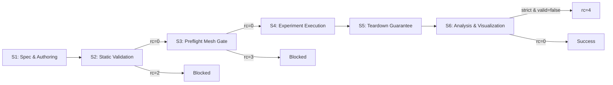

# GAIA Experiment Workflow & CLI Reference Guide

Comprehensive guide to GAIA's 6-stage experimentation pipeline, CLI subcommands, static validation gates, preflight reachability checks, MPTCP multi-path scenarios, data analysis, and SVG visualization.

---

## 1. Overview & 6-Stage Standard Workflow (S1 ~ S6)

GAIA establishes a disciplined, deterministic 6-stage lifecycle for reproducible network performance evaluation:



### Stage Breakdown

| Stage | Name | Description | Tools / Modules | Exit Code on Failure |
| :--- | :--- | :--- | :--- | :--- |
| **S1** | **Authoring** | Create/edit topology and experiment configuration files | Web UI (`webui/app.py`), text configs (`config/topo/`, `config/xp/`) | N/A |
| **S2** | **Static Validation** | Rootless syntax, reachability, IFNAMSIZ, and MPTCP feasibility check | `cli.py verify`, `core/validation.py`, `core/netmodel.py` | `rc=2` |
| **S3** | **Preflight Gate** | Mandatory Tier-1 bidirectional mesh reachability test | `cli.py preflight`, `experiments/mesh_ping.py` | `rc=3` |
| **S4** | **Execution** | Mininet network orchestration, sysctl lifecycle, and traffic generation | `cli.py exec`, `runner.py`, `core/experiment.py`, `experiments/iperf3_exp.py` | `rc=1` |
| **S5** | **Teardown** | Guaranteed network teardown and sysctl state restoration (try/finally) | `runner.py`, `core/experiment.py` | Guaranteed |
| **S6** | **Analysis & Vis** | Results aggregation, validity labeling, CSV export, and pure SVG charting | `cli.py analyze`, `core/analysis.py`, `core/pcapio.py` | `rc=4` (strict) |

---

## 2. CLI Command Reference

All CLI commands are accessible through `cli.py`.

### 2.1 `verify` (S2 Static Validation)
Runs non-privileged static validation of topology and experiment files:
```bash
# Validate topology only
python cli.py verify -t config/topo/topo_sc1_baseline

# Validate topology and experiment pair with JSON report
python cli.py verify -t config/topo/topo_sc2_mptcp_2path -x config/xp/xp_sc2_mptcp_2path --json
```

### 2.2 `preflight` (S3 Mesh Ping Reachability Gate)
Executes endpoint-level mesh ping reachability test before running heavy experiments:
```bash
python cli.py preflight -t config/topo/topo_sc1_baseline --count 3 --timeout 1 --max-probes 200
```
Options:
- `-t, --topo <file>`: Topology file (required)
- `--count <int>`: Ping packets per probe (default: 3)
- `--timeout <sec>`: Timeout per packet (default: 1)
- `--max-probes <int>`: Probe cap guard (default: 200)
- `--strict-mesh`: Fail if Tier-2 probes fail

### 2.3 `exec` (S4 Standard Workflow Entrypoint)
Executes the full automated workflow (S2 Verification $\to$ S3 Preflight $\to$ S4 Runner $\to$ S6 Analysis):
```bash
python cli.py exec -t config/topo/topo_sc2_mptcp_2path -x config/xp/xp_sc2_mptcp_2path
```
Options:
- `-t, --topo <file>`: Topology file (required)
- `-x, --xp <file>`: Experiment file (required)
- `--output-dir <dir>`: Custom output directory (defaults to timestamped `output/<YYYYMMDD-HHMMSS>`)
- `--skip-preflight`: Bypass S3 preflight mesh check
- `--pcap yes/no`: Capture packet traces globally across routers and hosts
*(Note: Per-node selective capture is configured via `pcap_nodes: <node1>,<node2>...` in the experiment file `config/xp/*`)*

### 2.4 `analyze` (S6 Data Analysis & Chart Generation)
Parses experiment logs, computes goodput/retransmits/subflows, enforces validity labels, and produces `results.csv`, `summary.json`, and SVG charts:
```bash
# Analyze latest run
python cli.py analyze

# Analyze specific run with strict validation gate
python cli.py analyze --run-dir output/2026-08-17_22-30-00 --strict
```

### 2.5 Utility Subcommands
- `clean [--purge-configs]`: Clean old output files and temporary artifacts.
- `merge <out.pcap>`: Merge pcap files from latest run using `mergecap -F pcap`.
- `mkexp <ClassName> <exp_name>`: Scaffold a new experiment template module.
- `run`: Run legacy performance-analysis experiments.
- `iperf`: Run legacy single-path iperf experiments.

---

## 3. Exit Code Contract

GAIA defines standard POSIX exit codes across all entrypoints:

| Exit Code | Classification | Trigger Condition |
| :---: | :--- | :--- |
| **0** | `SUCCESS` | Operation completed successfully, all validation checks passed. |
| **1** | `FATAL / GENERAL ERROR` | Runtime exception, missing parameters, runner crash, or Mininet error. |
| **2** | `STATIC VALIDATION ERROR` | Malformed config, duplicate nodes, invalid routes, IFNAMSIZ > 15 chars, or Generic + `mptcp:yes` static feasibility violation. |
| **3** | `PREFLIGHT REACHABILITY ERROR` | Tier-1 mesh ping reachability test failed (packet loss 100% on any Client $\leftrightarrow$ Server interface pair). |
| **4** | `ANALYSIS STRICT VALIDITY ERROR` | `cli.py analyze --strict` detected invalid run (e.g. `mptcp:yes` requested but `subflows < 2` fallback occurred). |

---

## 4. Parameter Reference & Mapping Guide

GAIA configuration files use `key:value` syntax with automatic list promotion for repeated keys.

### Topology Parameters (`config/topo/`)

| Parameter | Type | Default | Description |
| :--- | :--- | :--- | :--- |
| `topoType` | string | - | Topology type: `Generic`, `MultiIf`, `MultiInterfaceMultiClients` |
| `router` | csv | - | `Generic` router specification: `<name>,<subnet_cidr>,<optional_ip>` |
| `client` | csv | - | `Generic` client specification: `<name>,<attached_router>,<optional_ip>` |
| `server` | csv | - | `Generic` server specification: `<name>,<attached_router>,<optional_ip>` |
| `link` | csv | - | Link spec: `<a>,<b>,<delay_ms>,<queue_size>,<bw_mbps>,<loss_pct>,<backup_flag>` |
| `transitSubnet` | cidr | `172.31.0.0/16` | Pool for router-to-router `/30` point-to-point subnets |
| `changeNetem` | bool | `false` | Enable dynamic netem schedule (`true/false`, `yes/no`, `1/0`) |
| `netemAt` | csv | - | Schedule for Generic topo: `<link_idx>,<at_sec>,<netem_command>` |
| `netemAt_<type>_<id>` | csv | - | Schedule for MultiIf topo: `<at_sec>,<netem_command>` |

### Experiment Parameters (`config/xp/`)

| Parameter | Type | Default | Description |
| :--- | :--- | :--- | :--- |
| `xpType` | string | `iperf3_exp` | Experiment class: `iperf3_exp`, `mesh_ping`, `performance-analysis`, `tcp_exp`, etc. |
| `mptcp` | bool | `no` | Enable MPTCP (`yes/no`). Adds `--mptcp` to iperf3 and configures upstream endpoints. |
| `duration` | int | `10` | Experiment run duration in seconds (`-t`). |
| `parallel` | int | `1` | Number of parallel streams (`-P`). |
| `congctrl` | string | `cubic` | TCP/MPTCP Congestion control algorithm (restored on teardown). |
| `reverse` | bool | `no` | Run iperf3 in reverse mode (`-R`, server transmits to client). |
| `count` | int | `3` | Ping count for `mesh_ping`. |
| `timeout` | int | `1` | Ping timeout in seconds for `mesh_ping`. |
| `max_probes` | int | `200` | Safety threshold on total ping probes in `mesh_ping`. |
| `strict_mesh` | bool | `no` | Treat Tier-2 same-role ping failures as fatal in `mesh_ping`. |

---

## 5. Preflight Mesh Ping Verification (Tier 1 vs Tier 2)

Preflight mesh ping (`xpType:mesh_ping`) validates network reachability across all physical interfaces:

- **Tier 1 (Mandatory)**: All Client endpoints $\leftrightarrow$ All Server endpoints bidirectional.
  - Formula: $N_{\text{tier1}} = 2 \times |E_{\text{clients}}| \times |E_{\text{servers}}|$
  - Any failure in Tier 1 results in `verdict = "FAIL"` and `rc=3`.
- **Tier 2 (Informational)**: Same-role nodes primary endpoint reachability (Client $\leftrightarrow$ Client, Server $\leftrightarrow$ Server).
  - Formula: $N_{\text{tier2}} = |C|(|C|-1) + |S|(|S|-1)$
  - Failures in Tier 2 produce warnings, but pass unless `--strict-mesh` is active.

### Output: `reachability.json`
```json
{
  "topo_type": "MultiIf",
  "endpoints": [
    {"node": "c0", "role": "client", "iface": "c0-eth0", "ip": "192.168.0.2", "backup": false},
    {"node": "c0", "role": "client", "iface": "c0-eth1", "ip": "192.168.1.2", "backup": true},
    {"node": "s0", "role": "server", "iface": "s0-eth0", "ip": "10.2.0.2", "backup": false}
  ],
  "tier1": {"total": 4, "failed": 0},
  "tier2": {"total": 0, "failed": 0},
  "verdict": "PASS"
}
```

---

## 6. Standard Presets

The following standard scenario presets are provided in `config/topo/` and `config/xp/`:

### SC-1: Single-Path Baseline TCP
- **Topo**: `config/topo/topo_sc1_baseline` (Generic single router, single path)
- **XP**: `config/xp/xp_sc1_baseline` (TCP cubic, 10s duration)
- **Goal**: Verify baseline TCP goodput and latency.

### SC-2: Multi-Path MPTCP 2-Path
- **Topo**: `config/topo/topo_sc2_mptcp_2path` (`MultiIf`, 2 client interfaces)
- **XP**: `config/xp/xp_sc2_mptcp_2path` (MPTCP cubic, `mptcp:yes`, `max_subflows >= 2`)
- **Goal**: Verify simultaneous multipath aggregation across 2 subflows.

### SC-2b: Multi-Path MPTCP Server Signal
- **Topo**: `config/topo/topo_sc2b_mptcp_signal` (`MultiIf`, 2 client ifaces, 2 server ifaces)
- **XP**: `config/xp/xp_sc2b_mptcp_signal` (Server secondary iface registers with `signal` flag)
- **Goal**: Verify MPTCP `signal` endpoint advertisement and subflow establishment.

### SC-3: Multi-Path MPTCP Dynamic Failover
- **Topo**: `config/topo/topo_sc3_mptcp_failover` (`MultiIf` 2 paths + `netemAt_c2r_1:5.0,loss 100%`)
- **XP**: `config/xp/xp_sc3_mptcp_failover` (Dynamic link loss injection at $t=5\text{s}$)
- **Goal**: Verify MPTCP seamless failover to Path 0 when Path 1 is impaired.

---

## 7. Dynamic Network Emulation (Netem)

GAIA supports scheduled dynamic network impairments without stopping Mininet:

### Generic Topology Syntax
```
changeNetem:yes
netemAt:0,5.0,loss 20%
netemAt:0,10.0,delay 50ms loss 0%
```

### Delay Preservation Rule (WF-13)
When `tc qdisc replace` is executed dynamically, if the replacement command does **not** specify `delay`, GAIA automatically appends `delay <base_delay>ms limit 50000` to preserve the configured baseline latency rather than resetting it to zero.

---

## 8. MPTCP Kernel Requirements & Architecture

GAIA automatically detects the Linux kernel MPTCP implementation and configures upstream sysctl and endpoint parameters:

### Role-Aware Endpoint Configuration (WF-18, T-11b)
- **Client Nodes**:
  All client interfaces register as `subflow` endpoints:
  `ip mptcp endpoint add <client_ip> dev <client_iface> subflow [backup]`
- **Server Nodes**:
  - Primary interface (index 0): initial connection listener target (no endpoint registration needed unless backup).
  - Secondary interfaces (index > 0): registered as `signal` endpoints to announce secondary IPs:
    `ip mptcp endpoint add <server_ip> dev <server_iface> signal [backup]`

### Router IP Forwarding & Filtering (WF-15)
Multi-interface routers automatically enable:
`net.ipv4.ip_forward = 1`
`net.ipv4.conf.all.rp_filter = 0`

---

## 9. Analysis, PCAP IO & SVG Visualization

GAIA includes a zero-dependency analysis engine in `core/analysis.py` and `core/pcapio.py`.

### Artifacts Generated in Output Directory:
1. `results.csv`: Machine-readable tabular summary.
2. `summary.json`: Detailed JSON summary with validity verdict and unapplied parameters.
3. `goodput_chart.svg`: Standalone vector chart visualizing goodput and protocol comparison.
4. `subflows.json`: Asynchronous subflow sampling traces.
5. `reachability.json`: Preflight mesh reachability matrix.

### Validity Labels (T-15, D-12)
- `Valid Multipath`: MPTCP requested and `max_subflows >= 2`.
- `Valid Single-Path`: TCP requested.
- `Single-Path Fallback`: MPTCP requested but `max_subflows < 2` (causes `rc=4` under `analyze --strict`).
- `Valid Custom Workload`: Heterogeneous per-node workload executed, all client workloads completed with `rc=0`.
- `Custom Workload Failure(N)`: Heterogeneous workload where $N$ client workloads failed or timed out (causes `rc=4` under `analyze --strict`).
- `UnappliedParams(N)`: Warns when parameters could not be applied.

---

## 10. Test Suite & Verification

The test suite is executed using `tests/run_all.py`:
```bash
python tests/run_all.py
```
**Total Test Count**: **210 tests** across **32 test modules** covering:
- Scaling & Interface Naming (`tests/test_experiments_scaling.py`, `tests/test_iface_naming.py`)
- Config Naming & Traversal Defense (`tests/test_naming.py`)
- NetModel & Static Routing (`tests/test_netmodel.py`, `tests/test_generic_topo.py`, `tests/test_netmodel_roundtrip.py`, `tests/test_netmodel_role.py`)
- Preflight Mesh Ping (`tests/test_mesh_ping.py`)
- Dynamic Netem Scheduling (`tests/test_netem_schedule.py`)
- Role-Aware MPTCP Flags (`tests/test_mptcp_flags.py`, `tests/test_mptcp_mapping.py`)
- Sysctl Lifecycle Restoration (`tests/test_sysctl_lifecycle.py`)
- Web UI & API Endpoints (`tests/test_webui.py`, `tests/test_webui_v2.py`)
- Per-Node Workloads & Binding (`tests/test_workload.py`, `tests/test_workload_exp.py`, `tests/test_scenario_gen_workload.py`)
- Workload Analysis & Labels (`tests/test_analysis_workload.py`, `tests/test_cli_security.py`)
- Binary PCAP IO (`tests/test_pcapio.py`)
- Analysis & Chart Rendering (`tests/test_analysis.py`)
- CLI 6-Stage Workflow & Gates (`tests/test_cli_workflow.py`, `tests/test_validation_deep.py`, `tests/test_integration_phase5.py`)
- MAM Automation Skills Engine (`tests/test_topo_gen.py`, `tests/test_scenario_gen.py`, `tests/test_run_analyze.py`, `tests/test_skills_e2e.py`)

---

## 11. Troubleshooting & FAQ

### Q1: Why did `cli.py verify` return exit code 2 on Generic topology with MPTCP?
**A**: Generic topologies assign a single IP address per host. Linux upstream MPTCP requires at least 2 distinct IP addresses/interfaces on either client or server to establish secondary subflows. Use `topoType:MultiIf` for MPTCP experiments (WF-16).

### Q2: Why did `cli.py preflight` fail with exit code 3?
**A**: Preflight detected 100% packet loss on one or more Tier-1 (Client $\leftrightarrow$ Server) interface pairs. Check router IP forwarding, interface routes, or link loss settings in your topology.

### Q3: How do I view generated SVG charts?
**A**: SVG charts (`goodput_chart.svg`) are standard standalone SVG files that can be opened in any web browser, image viewer, or embedded in HTML/Markdown documents without any rendering dependencies.

---

## 12. Autonomous Experiment Loop Template (MAM Integration)

The GAIA experiment pipeline integrates directly into the `multi-agent-mux-loop` orchestration loop across three agent roles:

```
+-------------------------------------------------------------------------+
| Planner Agent                                                           |
| 1. Natural Language Goal -> TopoSpec (JSON) -> gaia-topo-gen            |
| 2. Verified Topo -> ScenarioSpec (JSON) -> gaia-scenario-gen           |
+------------------------------------+------------------------------------+
                                     |
                                     v
+------------------------------------+------------------------------------+
| Creator Agent                                                           |
| 1. Inspection: gaia-run-analyze -t <topo> -x <xp> --dry-run --json      |
| 2. Execution : sudo python3 -m tools.gaia_skills.run_analyze ...        |
+------------------------------------+------------------------------------+
                                     |
                                     v
+------------------------------------+------------------------------------+
| Reviewer Agent                                                          |
| 1. Verdict Evaluation: gaia-run-analyze --analyze-only --strict --json  |
|    - label in ("Valid Multipath", "Valid Single-Path",                  |
|                "Valid Custom Workload") (rc=0) -> [VERDICT: PASS]       |
|    - label in ("Single-Path Fallback", "No Data",                       |
|                "Custom Workload Failure(*)") (rc=4) -> Re-plan          |
+-------------------------------------------------------------------------+
```

### Protocol & Exit Code Contract

| Code | Stage | Semantic | Actionable Loop Next Step |
|---|---|---|---|
| `0` | S1~S6 | Success | Proceed to next experiment or report PASS |
| `1` | S4/S6 | Runtime / Fatal Error | Examine Mininet/process logs |
| `2` | S2 | Static Validation Failure | Planner modifies `TopoSpec`/`ScenarioSpec` |
| `3` | S3 | Preflight Reachability Loss | Planner adjusts link routing or IP assignment |
| `4` | S6 | Strict Validity Violation | Re-plan with verified kernel MPTCP endpoints |

---

## 13. MAM Automation Skills Reference

The following three skills are located in `.agents/skills/`:

### 1. `gaia-topo-gen`
- **Location**: `.agents/skills/gaia-topo-gen/` (engine: `tools/gaia_skills/topo_gen.py`)
- **Purpose**: Generates validated topology files (`config/topo/<name>`) from `TopoSpec` JSON. Enforces family selection matrix (`MultiIf` for MPTCP, `Generic` for multi-router/IPAM) and self-validates with `cli.py verify`.
- **IPAM Allocation**: Topologies generated with `intent: "single_path"` or `intent: "multi_router"` emit concise host declarations (`client:c0,r0`, `server:s0,r1`, `idle:h0,r0`) without hardcoded host IPs, allowing deterministic IPAM (`NetModel.allocate()`) to assign subnet addresses at load time.

### 2. `gaia-scenario-gen`
- **Location**: `.agents/skills/gaia-scenario-gen/` (engine: `tools/gaia_skills/scenario_gen.py`)
- **Purpose**: Generates validated scenario files (`config/xp/<name>`) from `ScenarioSpec` JSON. Consumes topology metadata to safely set MPTCP flags and enforces mandatory keys for `iperf3_exp`, `mesh_ping`, `performance-analysis`, and `workload_exp`.
- **Bidirectional Parser**: Provides `parse_scenario_file()` for seamless roundtrip parsing and WebUI rehydration.

### 3. `gaia-run-analyze`
- **Location**: `.agents/skills/gaia-run-analyze/` (engine: `tools/gaia_skills/run_analyze.py`)
- **Purpose**: Orchestrates full execution, dry-run inspection (`--dry-run`), post-hoc strict validation (`--analyze-only`), and Herdr session-based root emulation delegation (`--herdr-workspace`, `--herdr-session`, `--setup`, `--timeout`), returning machine-readable JSON verdicts.

---

## 14. Heterogeneous Workloads & Custom Command Execution (Phase 5)

GAIA supports per-node heterogeneous workloads across Generic topologies using `xpType:workload_exp`:

### 14.1 Workload Declaration Syntax (`config/xp/*`)
```
xpType:workload_exp
duration:10
mptcp:no
pcap:no
pcap_nodes:c0,s0
congctrl:cubic
workload:s0,custom_server,python3 -m http.server 8080
workload:c0,custom_client,curl -s {server_ip:s0}:8080 -o {output_dir}/res.txt
workload:h0,none
```

### 14.2 Supported Workload Kinds
1. `none`: No traffic generated (background/idle node).
2. `iperf3_server`: iPerf3 background JSON daemon.
3. `iperf3_client`: iPerf3 client throughput stream.
4. `mesh_ping`: Ping probes towards servers.
5. `custom_server`: Background server process (PID tracked and gracefully terminated during teardown).
6. `custom_client`: Client process evaluated by exit code (`rc=0` -> PASS).

### 14.3 Secure Placeholder Substitution (D-9)
Custom commands can safely bind runtime topology context using whitelist tokens:
- `{server_ip}` / `{server_ip:<node>}`: Target server IPv4 address.
- `{client_ip}` / `{client_ip:<node>}`: Client IPv4 address.
- `{node}`: Local node name (e.g. `c0`).
- `{iface}`: Primary interface name (e.g. `c0-eth0`).
- `{duration}`: Scenario duration in seconds.
- `{output_dir}`: Run output directory path.

### 14.4 Execution Security Gate (S-4)
To prevent accidental or unprivileged execution of arbitrary shell commands in scenarios:
- `cli.py exec` strictly rejects scenarios containing `custom_*` workloads with exit code `rc=2` unless explicitly passed `--allow-custom-cmd`.
- Security violations clearly print the target node name and full command string before aborting.
